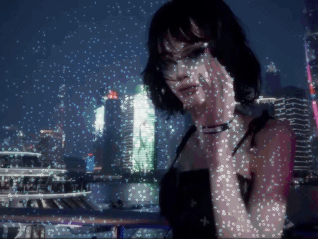
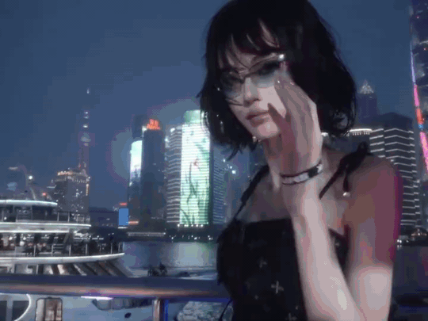
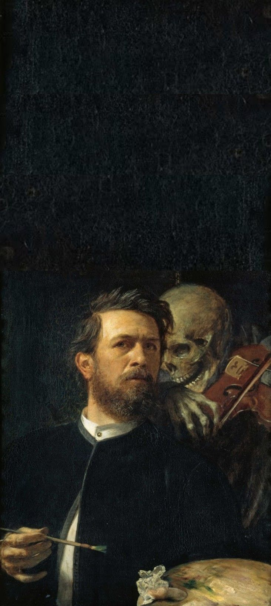
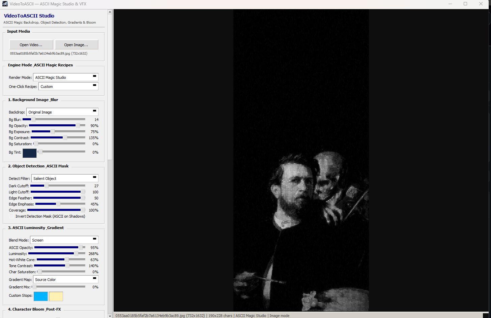
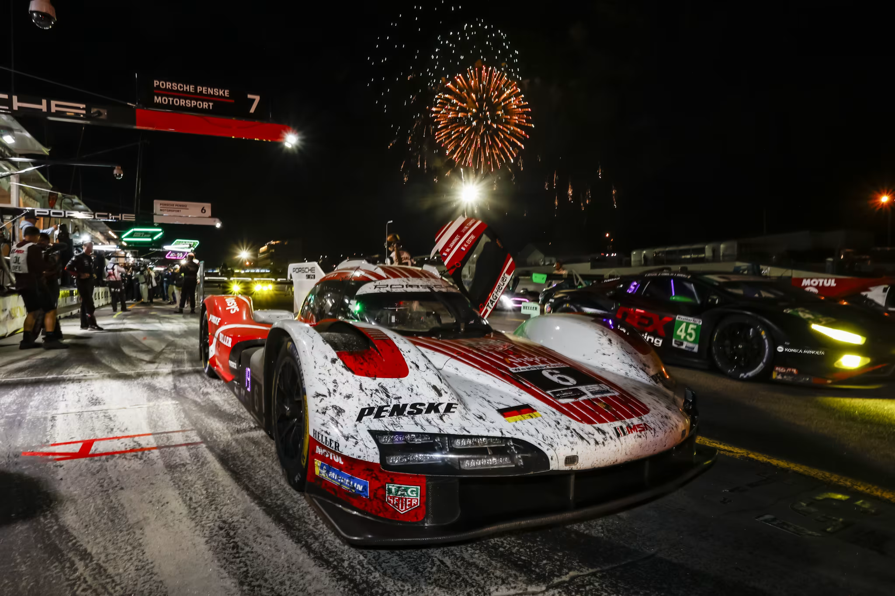
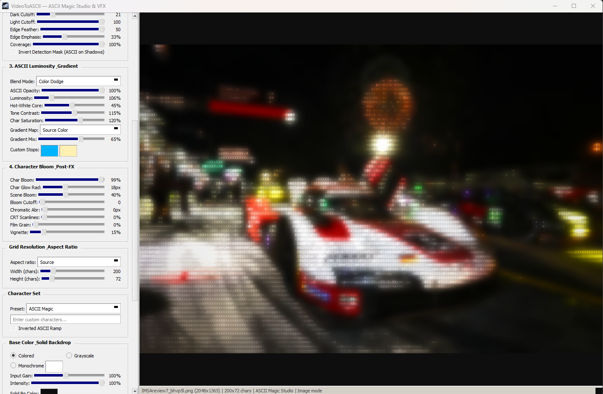
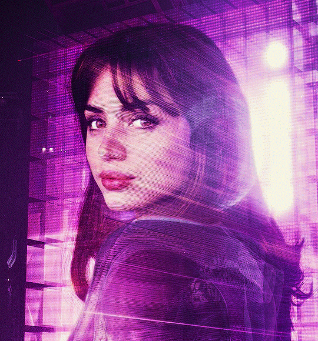
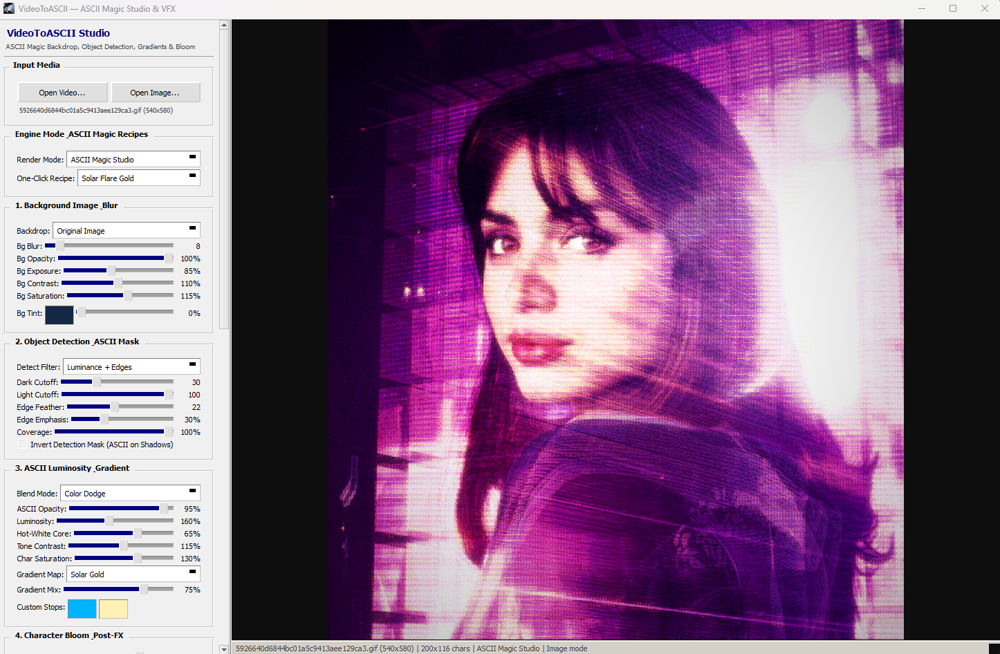

<div align="center">

# VIDEO TO ASCII

### Luminance Compositing Studio & Layered Glyph VFX Engine

[](https://github.com/Fearcine/Video-to-Ascii-convertor)
[](https://www.python.org/)
[](https://pypi.org/project/PyQt6/)
[](https://opencv.org/)
[](LICENSE)

<br>

*A real-time desktop studio and headless optical rendering engine that transforms video footage and still imagery into high-luminance, full-color typographic artworks, emissive glyph fields, and bloom-graded motion sequences.*

<br>



<br>

<sub><b>Layered Glyph VFX Mode ("Scattered Lumina")</b> — Poisson-disk glyph instances aligned to image gradient tangents, selective subject masking, multi-scale emissive stroke bloom, and deterministic temporal wind sway over graded night footage.</sub>

</div>

<br>

## I. The Optical Problem & The Studio Upgrade

Conventional ASCII converters render every cell of a rigid character grid over a flat black canvas. Because typographic glyphs occupy only 15% to 35% of their rectangular cell area (and sparse punctuation marks such as `.`, `:`, `+` cover less than 10%), up to 85% of display luminance is lost to dead space. Dark background regions collapse into a noisy wall of characters, while bright highlights appear dim and washed out.

This release introduces a decoupled, five-stage **ASCII Magic Studio & Layered Glyph VFX Engine** (`vfx/`) alongside the original high-speed **Classic Grid** renderer:

1. **Full-Resolution Graded Backdrops (`vfx/grading.py`)**: Composites the original video or image frame underneath the typographic layer as a `Blurred Image`, `Original Image`, `Frosted Glass` diffuser, or `Solid Color` canvas with independent controls for Gaussian blur radius, opacity, exposure/brightness, contrast, saturation (`0%` for monochrome backing), and luminance-preserving RGB color tinting.
2. **Salient Subject & Contour Isolation (`vfx/fields.py`)**: Eliminates background character clutter using a configurable `[Dark Cutoff, Light Cutoff]` luminance window with smooth Hermite (`smoothstep`) edge feathering, Sobel gradient magnitude emphasis, automatic `Salient Object` foreground detection (combining border color distance, Difference-of-Gaussians local contrast, and edge density), and 8×8 Bayer ordered dither coverage (`coverage`) so the graded backdrop breathes naturally through gaps between glyphs.
3. **Incandescent Highlight Cores & Gradient LUTs (`vfx/lighting.py`)**: Amplifies character RGB luminance (`50%` to `300%`), drives peak highlights toward a `255` hot-white core while preserving midtone chroma, and maps tonal values across 9 built-in and custom 256-entry color gradient look-up tables.
4. **Per-Character Emissive Bloom & Optical Blending (`vfx/bloom.py`, `vfx/compositor.py`)**: Computes multi-scale Gaussian stroke glow (`charBloom`) directly from isolated character masks before compositing via `Screen`, `Add (Linear Dodge)`, `Color Dodge`, `Overlay`, `Soft Light`, or `Normal` blend modes, paired with a 1px micro-contrast shadow so glowing glyphs remain legible over bright clouds and specular highlights.
5. **Spatial Particle Scatter & Stackable Post-FX (`vfx/distribution.py`, `vfx/glyph_bank.py`)**: Introduces **Layered Glyph VFX** mode, scattering up to 6,000 rotated and scaled glyph sprites in resolution-independent `[0, 1]²` coordinates (`Poisson Disk` or `Jittered Grid`) aligned to image gradient tangents or normals with deterministic wind animation, finished with Chromatic Aberration, CRT Scanlines, Film Grain, and Radial Vignette.

<br>

## II. Motion Exhibition: Source Footage vs. Layered Glyph VFX

<table>
  <tr>
    <th width="50%" align="center">Original Source Sequence (<code>assets/demo.mp4</code>)</th>
    <th width="50%" align="center">Layered Glyph VFX Output (<code>assets/demo-scatter.mp4</code>)</th>
  </tr>
  <tr>
    <td width="50%" align="center">
      
    </td>
    <td width="50%" align="center">
      
    </td>
  </tr>
  <tr>
    <td align="center"><sub>Raw 30 FPS multi-scene night portrait sequence</sub></td>
    <td align="center"><sub>Poisson-disk scattered glyphs, gradient-tangent rotation, smoothstep density thinning, and emissive bloom</sub></td>
  </tr>
</table>

<br>

## III. Visual Studies: Source vs. Studio Output

Each study below pairs the unedited source image from `assets/` directly against the real-time PyQt6 studio workspace capture and active optical pipeline parameters.

### Study I — Chiaroscuro & Salient Subject Isolation

By setting the detection filter to `Salient Object` and desaturating both the backdrop and character layer (`0%` saturation), the engine isolates the foreground painter and skeletal figure from Arnold Böcklin's *Self-Portrait with Death Playing the Fiddle* (1872). The upper canvas void remains completely free of character noise while facial structure and bone contours are sculpted in high-contrast monochrome glyphs (`268%` Luminosity, `63%` Hot-White Core, `Screen` blend).

<table>
  <tr>
    <th width="23%" align="center">Source Artwork (<code>demo-painting.png</code>)</th>
    <th width="77%" align="center">ASCII Magic Studio Output &amp; Parameters (<code>demo-painting-exp.png</code>)</th>
  </tr>
  <tr>
    <td width="23%" align="center">
      
    </td>
    <td width="77%" align="center">
      
    </td>
  </tr>
  <tr>
    <td colspan="2" align="center">
      <sub><b>Recreation Recipe</b>: Mode: <code>ASCII Magic Studio</code> · Backdrop: <code>Original Image</code> (Blur <code>14</code>, Opacity <code>90%</code>, Exposure <code>75%</code>, Contrast <code>135%</code>, Saturation <code>0%</code>) · Detection: <code>Salient Object</code> (Dark Cutoff <code>27</code>, Edge Feather <code>50</code>, Edge Emphasis <code>45%</code>) · Illumination: <code>Screen</code> Blend, Luminosity <code>268%</code>, Hot-White Core <code>63%</code>, Char Saturation <code>0%</code>, Grid <code>190×228</code></sub>
    </td>
  </tr>
</table>

<br>

### Study II — Incandescent Highlights & Per-Character Bloom

Night endurance racing photography presents extreme dynamic range: dark asphalt, specular carbon-fiber reflections, tungsten pit lighting, and aerial fireworks. Using `Color Dodge` blending over a softly blurred backdrop with `99%` Per-Character Bloom (`18px` glow radius) and `40%` Scene Bloom transforms the fireworks, headlights, and red-and-white livery into self-luminous typographic structures.

<table>
  <tr>
    <th width="50%" align="center">Source Photograph (<code>demo-nascar.png</code>)</th>
    <th width="50%" align="center">ASCII Magic Studio Output &amp; Parameters (<code>demo-nascar-exp.png</code>)</th>
  </tr>
  <tr>
    <td width="50%" align="center">
      
    </td>
    <td width="50%" align="center">
      
    </td>
  </tr>
  <tr>
    <td colspan="2" align="center">
      <sub><b>Recreation Recipe</b>: Mode: <code>ASCII Magic Studio</code> · Detection: Dark Cutoff <code>21</code>, Edge Feather <code>50</code>, Edge Emphasis <code>33%</code> · Illumination: <code>Color Dodge</code> Blend, Luminosity <code>106%</code>, Hot-White Core <code>45%</code>, Char Saturation <code>120%</code> · Bloom: Char Bloom <code>99%</code> (Radius <code>18px</code>), Scene Bloom <code>40%</code>, Vignette <code>15%</code>, Grid <code>200×72</code> (<code>ASCII Magic</code> ramp)</sub>
    </td>
  </tr>
</table>

<br>

### Study III — Chromatic Gradient Mapping & Solar Core

Applied to a neon-lit portrait (`demo-ana.png`), the `Solar Flare Gold` recipe blends a `75%` `Solar Gold` gradient map with the source magenta-violet lighting via `Color Dodge`. The `Luminance + Edges` detector suppresses characters in deep hair and background shadows (`Dark Cutoff: 30`) while driving skin and background highlights toward a warm, incandescent gold core.

<table>
  <tr>
    <th width="38%" align="center">Source Portrait (<code>demo-ana.png</code>)</th>
    <th width="62%" align="center">ASCII Magic Studio Output &amp; Parameters (<code>demo-ana-ex.png</code>)</th>
  </tr>
  <tr>
    <td width="38%" align="center">
      
    </td>
    <td width="62%" align="center">
      
    </td>
  </tr>
  <tr>
    <td colspan="2" align="center">
      <sub><b>Recreation Recipe</b>: Mode: <code>ASCII Magic Studio</code> · Recipe: <code>Solar Flare Gold</code> · Backdrop: <code>Original Image</code> (Blur <code>8</code>, Exposure <code>85%</code>, Contrast <code>110%</code>, Saturation <code>115%</code>) · Detection: <code>Luminance + Edges</code> (Dark Cutoff <code>30</code>, Edge Feather <code>22</code>, Edge Emphasis <code>30%</code>) · Illumination: <code>Color Dodge</code> Blend, Luminosity <code>160%</code>, Hot-White Core <code>65%</code>, Gradient Map: <code>Solar Gold</code> (Mix <code>75%</code>), Grid <code>200×116</code></sub>
    </td>
  </tr>
</table>

<br>

## IV. Why Local Open-Source Over Paid Web Generators

Browser-based ASCII and shader platforms frequently lock advanced effect libraries, studio dithering, and high-resolution video exports behind monthly Pro subscriptions ($48 to $96/year) or metered render credits, while struggling with browser memory caps on long video files. **Video to ASCII** runs locally on your hardware with zero restrictions.

| Capability | Video to ASCII (Local Open-Source Studio) | Paid Online & Freemium Browser Tools |
| :--- | :--- | :--- |
| **Cost & Licensing** | **100% Free & Open Source (MIT)** — every shader, blend mode, gradient LUT, and recipe unlocked permanently | Free tiers restrict studio effects or resolution; full shader libraries and 4K/pro exports require **$4–$8/mo subscriptions** or paid credit packs |
| **Video Export Limits** | **Unlimited duration, frame rate, and resolution** — export full-length MP4 videos, high-DPI PNGs, TXT streams, and HTML | Browser WebGL texture ceilings, short duration caps, render queues, or metered export credits |
| **Media Privacy** | **100% Offline Local Execution** — unreleased edits, personal portraits, and client footage never leave your disk | Requires loading media into browser sandboxes or uploading clips to external cloud processing servers |
| **Real-Time Scrubbing** | **Multithreaded C++/OpenCV SIMD & NumPy** — instant paused-frame re-rendering and deadline-scheduled playback | Heavy DOM/Canvas overhead that drops frames or crashes browser tabs on high-density grids |
| **Temporal Stability** | **Seed-Deterministic `[0, 1]²` Coordinates** — monotonic `smoothstep` thinning and `t = frame_index / fps` wind math prevent glyph popping | Frame-independent random noise that shimmers or boils unpredictably during video export |
| **Programmability** | **Qt-Free Python SDK (`vfx/`)** — script batch renders, custom LUTs, or automated pipelines directly in Python | Closed proprietary web UI with no local CLI or programmatic batch API |

<br>

## V. Optical Architecture & What Changed

The rendering core (`vfx/`) is architected as a stateless, Qt-free image processing pipeline that accepts any BGR `numpy.ndarray` frame and returns a composited RGB `uint8` frame alongside the underlying 2D character and color grids:

```text
Input Frame (BGR uint8)
  │
  ├──► Stage 1: Backdrop Grading (vfx/grading.py)
  │      └─ Original | Gaussian Blurred | Frosted Glass | Solid Color
  │         + Exposure, Contrast, Saturation, Luminance-Preserving RGB Tint
  │
  ├──► Stage 2: Spatial & Saliency Analysis (vfx/fields.py)
  │      └─ Luminance + Sobel Edges | Salient Object (Border Dist + DoG) | Edges Only
  │         + [Dark, Light] Hermite Smoothstep Window + 8×8 Bayer Ordered Dither
  │
  ├──► Stage 3: Illumination & Gradient Mapping (vfx/lighting.py)
  │      └─ Gamma-Corrected Ramp Lookup + 256-Entry Gradient LUT Mix
  │         + Luminosity Boost (50–300%) + Edge Lift + Incandescent Hot-White Core
  │
  ├──► Stage 4: Glyph Compositing (vfx/compositor.py, glyph_atlas.py, vfx/glyph_bank.py)
  │      ├─ ASCII Magic Studio: 1px Micro-Contrast Shadow + Isolated Char Bloom + 6 Blend Modes
  │      └─ Layered Glyph VFX:  Poisson-Disk / Jittered [0,1]² Scatter + Gradient Tangent Rotation + Wind
  │
  └──► Stage 5: Scene Highlight Bloom & Post-FX (vfx/bloom.py)
         └─ Multi-Scale Pyramid Highlight Bloom + Chromatic Aberration + CRT Scanlines + Film Grain + Vignette
```

### File-by-File Upgrade Summary

| File / Module | Status | Summary of Changes & Responsibilities |
| :--- | :--- | :--- |
| `vfx/__init__.py` | **Added** | Exports `VfxSettings`, `VfxEngine`, `get_vfx_engine`, `VFX_PRESETS`, and `get_preset_settings`. |
| `vfx/settings.py` | **Added** | Defines the frozen, slotted `VfxSettings` dataclass with parameter validation (`validated()`) and JSON serialization (`to_dict()` / `from_dict()`). |
| `vfx/grading.py` | **Added** | Implements `render_background_layer()` for full-resolution `Blurred Image`, `Original Image`, `Frosted Glass`, and `Solid Color` backdrops with exposure, contrast, saturation, tint, and opacity grading. |
| `vfx/fields.py` | **Added** | Implements `compute_analysis_maps()` for `Luminance + Edges`, `Luminance Threshold`, `Salient Object` (border color distance + Difference-of-Gaussians + edge density), `Edges Only`, and `Full Frame` detection, plus `smoothstep` feathering and 8×8 Bayer dither coverage. |
| `vfx/lighting.py` | **Added** | Implements `compute_illuminated_colors()` with 256-entry RGB gradient LUT caching, `gradient_mix` blending, `luminosity_boost`, edge lift, and `highlight_power` hot-white core illumination. |
| `vfx/bloom.py` | **Added** | Implements `compute_character_bloom()` (isolated 1/2 and 1/4 res stroke glow), `apply_scene_bloom()` (multi-scale highlight pyramid bloom), and `apply_post_fx()` (chromatic shift, CRT scanlines, film grain, and radial vignette). |
| `vfx/compositor.py` | **Added** | Implements OpenCV C++ SIMD-accelerated `composite_ascii_magic_grid()` (1px micro-contrast shadow + per-character bloom + 6 blend modes) and `composite_scattered_instances()`. |
| `vfx/distribution.py` | **Added** | Generates deterministic, seed-cached normalized `[0, 1]²` candidate points (`Poisson Disk` and `Jittered Grid`) with monotonic threshold `u` values for flicker-free density thinning. |
| `vfx/glyph_bank.py` | **Added** | Pre-renders and caches rotated (`12` angle bins) and scaled (`3` size bins) glyph sprite masks with optional 1px outline rings, reusing `glyph_atlas.py` CJK font routing. |
| `vfx/presets.py` | **Added** | Defines 9 curated one-click recipes (`Cloud Glow (ASCII Magic)`, `Cyberpunk Neon`, `Matrix Phosphor`, `Solar Flare Gold`, `Salient Subject Spotlight`, `Edge Contour Neon`, `Vaporwave Sunset`, `Film Noir Grain`, and `Scattered Lumina (VFX)`). |
| `vfx/engine.py` | **Added** | Orchestrates the complete `render_ascii_magic_studio()` and `render_scattered_vfx()` pipelines cleanly without any Qt dependency. |
| `main.py` | **Updated** | Adds 6 new sidebar control groups (`Engine Mode & ASCII Magic Recipes`, `1. Background Image & Blur`, `2. Object Detection & ASCII Mask`, `3. ASCII Luminosity & Gradient`, `4. Character Bloom & Post-FX`, `5. Scattered Glyph Instances`) and wires all image/video preview and export actions to the new engine. |
| `ascii_renderer.py` | **Updated** | Adds `ASCII Magic` (`" .,:-+=xX80S#@"`), `Detailed`, `Minimal`, and `Binary` (`" 01"`) character ramps to `CHAR_SETS` while keeping all existing ramps and functions unchanged. |
| `glyph_atlas.py` | **Updated** | Extends Latin and CJK font fallback lists (`DejaVuSansMono`, `LiberationMono`, `NotoSansCJK`, `NotoSerifCJK`) after Windows system fonts for cross-platform rendering. |
| `render_settings.py` | **Updated** | Adds `charset_hint`, `render_mode` (`"ASCII Magic Studio"`, `"Layered Glyph VFX"`, `"Classic Grid"`), and `vfx: VfxSettings` to `RenderSettings`. |
| `render_thread.py` | **Updated** | Integrates `VfxEngine` into the real-time video playback loop, fixes `font_size` and `charset_hint` round-tripping, and re-renders the current frame immediately when sliders are adjusted while paused. |
| `export.py` | **Updated** | Adds `render_single_frame_rgb()` and updates `ExportMP4Thread`, `ExportVideoThread`, and `export_full_html()` so MP4, PNG, TXT, and HTML exports match the active studio/VFX preview. |
| `shared_utils.py` | **Updated** | Adds Unicode-safe `read_image_bgr()` (NumPy `fromfile` + `cv2.imdecode` + Pillow fallback) and `compute_grid_height()` using exact font cell aspect ratio (`cell_w / cell_h`). |
| `settings.py` | **Updated** | Resets `settings.json` to clean factory defaults when the application is closed (`reset_settings_on_close()`) so every launch starts fresh. |
| `tests/test_ascii_magic_vfx.py` | **Added** | Unit and property test suite covering `VfxSettings` serialization/validation, background grading, object/edge/saliency masking, luminosity boost, character bloom, recipes, and scattered VFX determinism. |
| `tools/bench_vfx.py` | **Added** | Benchmarks frame render times and memory allocations across `ASCII Magic Studio` and `Layered Glyph VFX` modes. |

<br>

## VI. Curated One-Click Recipes

Select any recipe from the **One-Click Recipe** dropdown in the sidebar to configure all five pipeline stages automatically, then fine-tune any slider in real time (even while video playback is paused):

| Recipe Name | Engine Mode | Optical Signature |
| :--- | :--- | :--- |
| **Cloud Glow (ASCII Magic)** | `ASCII Magic Studio` | Softly blurred full-brightness backdrop (`bg_blur=10`), `Luminance + Edges` mask (`coverage=76%`), `Sky & Cloud Glow` gradient mix, hot-white core, and `Screen` character bloom. |
| **Cyberpunk Neon** | `ASCII Magic Studio` | Deep violet-tinted blurred backdrop, high edge emphasis (`65%`), `Cyberpunk Neon` cyan-magenta gradient, `Add (Linear Dodge)` blend, strong character bloom, chromatic aberration, and CRT scanlines. |
| **Matrix Phosphor** | `ASCII Magic Studio` | Japanese CJK character ramp over a dark emerald-tinted backdrop with `Matrix Phosphor` gradient, CRT scanlines (`35%`), and green phosphor bloom (`(80, 255, 140)`). |
| **Solar Flare Gold** | `ASCII Magic Studio` | Crisp dimmed original backdrop with `Solar Gold` gradient (`75%` mix), `Color Dodge` blending, incandescent white-gold highlight cores (`65%`), and warm scene bloom. |
| **Salient Subject Spotlight** | `ASCII Magic Studio` | `Frosted Glass` backdrop paired with automatic `Salient Object` foreground detection so only the primary subject receives glowing source-colored ASCII glyphs. |
| **Edge Contour Neon** | `ASCII Magic Studio` | Crisp original backdrop with `Edges Only` detection (`edge_emphasis=90%`) tracing structural outlines in luminous `Ice Crystal` neon characters. |
| **Vaporwave Sunset** | `ASCII Magic Studio` | Dense block glyphs (`░▒▓█`) over a violet-tinted blurred backdrop with `Vaporwave` magenta-aqua gradient, scanlines, and chromatic shift. |
| **Film Noir Grain** | `ASCII Magic Studio` | High-contrast monochrome `Detailed` ramp over a desaturated backdrop (`0%` saturation) with organic film grain (`28%`) and deep radial vignette (`45%`). |
| **Scattered Lumina (VFX)** | `Layered Glyph VFX` | Up to 2,800 Poisson-disk scattered glyph instances aligned to `Image Gradient Tangent` with animated harmonic wind sway and emissive bloom. |

<br>

## VII. Studio Controls & Multi-Script Typography

### Sidebar Control Modules

| Sidebar Module | Parameters & Ranges | Optical Effect |
| :--- | :--- | :--- |
| **1. Background Image & Blur** | `Backdrop` (`Blurred Image`, `Original Image`, `Frosted Glass`, `Solid Color`), `Bg Blur` (`0–100`), `Bg Opacity` (`0–100%`), `Bg Exposure` (`0–200%`), `Bg Contrast` (`20–200%`), `Bg Saturation` (`0–200%`), `Bg Tint` | Grades, blurs, or tints the underlying full-resolution video/image frame before ASCII compositing. |
| **2. Object Detection & Mask** | `Detect Filter` (`Luminance + Edges`, `Luminance Threshold`, `Salient Object`, `Edges Only`, `Full Frame`), `Dark Cutoff` (`0–100`), `Light Cutoff` (`0–100`), `Edge Feather` (`0–50`), `Edge Emphasis` (`0–100%`), `Coverage` (`0–100%`), `Invert Mask` | Isolates illuminated subjects or structural contours and thins glyph density via 8×8 Bayer ordered dithering. |
| **3. Luminosity & Gradient** | `Blend Mode` (`Screen`, `Add`, `Color Dodge`, `Overlay`, `Soft Light`, `Normal`), `ASCII Opacity` (`0–100%`), `Luminosity` (`50–300%`), `Hot-White Core` (`0–100%`), `Tone Contrast` (`20–200%`), `Char Saturation` (`0–200%`), `Gradient Map`, `Gradient Mix` (`0–100%`), `Custom Stops` | Controls glyph radiance, incandescent highlight centers, 256-entry gradient LUT mixing, and backdrop blend math. |
| **4. Character Bloom & Post-FX** | `Char Bloom` (`0–100%`), `Char Glow Rad` (`1–50px`), `Scene Bloom` (`0–100%`), `Bloom Cutoff` (`0–100`), `Chromatic Abr` (`0–20px`), `CRT Scanlines` (`0–100%`), `Film Grain` (`0–100%`), `Vignette` (`0–100%`) | Generates multi-scale emissive halos around individual character strokes and applies final optical post-processing. |
| **5. Scattered Glyph Instances** | `Distribution` (`Poisson Disk`, `Jittered Grid`), `Density` (`0–100%`), `Max Glyphs` (`50–6000`), `Glyph Scale` (`0.25–4.0x`), `Size Jitter` (`0–100%`), `Orientation` (`Fixed`, `Image Gradient Tangent`, `Image Gradient Normal`, `Random`), `Wind Sway` (`0–100%`), `Outline` | Controls spatial particle distribution, contour-following rotation, and harmonic wind sway in `Layered Glyph VFX` mode. |
| **6. Grid & Character Sets** | `Width` (`20–800` cols), `Height`, `Aspect Ratio` (`Source`, `1:1`, `4:3`, `3:2`, `16:9`, `16:10`, `21:9`, `Custom`), `Preset` (10 built-in ramps or Custom string), `Export Font Size` (`4–32px`) | Configures character grid resolution, aspect ratio locking, Latin/CJK glyph ramps, and export rasterization scale. |

### Built-In Character Ramps (Sorted Sparse to Dense by Measured Pixel Coverage)

| Ramp Name | Character Sequence | Script & Visual Character |
| :--- | :--- | :--- |
| **ASCII Magic** | `" .,:-+=xX80S#@"` | Balanced 14-step studio ramp optimized for emissive bloom and contour legibility. |
| **Standard** | `" .:,*;?+S%#@"` | Classic 12-step typographic ramp for general video and portrait rendering. |
| **Detailed** | `" .':,;+=-*xX08S#$&%@"` | Extended 20-step fine tonal ramp ideal for monochrome and chiaroscuro studies. |
| **Minimal** | `" .:-=+*#%@"` | Clean 10-step geometric ramp with high negative space. |
| **Dense** | `" ░▒▓█"` | Unicode shade blocks for smooth halftone and vaporwave gradients. |
| **Simple** | `" █"` | High-contrast binary solid block mask. |
| **Binary** | `" 01"` | Digital binary stream ramp. |
| **Japanese** | `" 一いアんカの木水あ月日足黎達機鬱響"` | 17-step Hiragana, Katakana, and Kanji ramp with automatic CJK font routing. |
| **Chinese** | `" 二上川土女口王字金正右草海織龍鬱響"` | 17-step Hanzi stroke-density ramp from sparse (`二`) to ultra-dense (`響`). |
| **Best Mix** | `" :,*しア;+小のき大水口あ#海愛@響"` | Hybrid Latin + CJK ramp combining fine punctuation with complex ideographs. |

<br>

## VIII. Export Formats Matrix

All visual exports (`MP4` and `PNG`) render through the exact active studio or VFX pipeline at your chosen **Export Font Size** (`4px` to `32px`), independent of the preview window size.

| Export Action | Output Format | Supported Modes | Details |
| :--- | :--- | :--- | :--- |
| **Export as ASCII MP4** | `.mp4` (H.264 / MPEG-4) | `ASCII Magic Studio`, `Layered Glyph VFX`, `Classic Grid` | Renders every frame of the source video with full backdrop grading, object masking, bloom, and post-FX. |
| **Export as ASCII PNG** | `.png` (24-bit RGB) | `ASCII Magic Studio`, `Layered Glyph VFX`, `Classic Grid` | Saves the active video frame or still image at full export font resolution with all optical effects applied. |
| **Save ASCII Text** | `.txt` (Frame Sequence) | `ASCII Magic Studio`, `Classic Grid` | Writes all video frames as plain text (`FRAME_START` / `FRAME_END`), respecting active object detection masking. |
| **Save Current Frame** | `.txt` / `.html` | `ASCII Magic Studio`, `Classic Grid` | Exports the current frame as plain text or self-contained per-character colored HTML. |
| **Export Frame as HTML** | `.html` (Styled DOM) | `ASCII Magic Studio`, `Classic Grid` | Generates a standalone dark-canvas HTML document with inline RGB `<span>` styling at the selected font size. |

<br>

## IX. Installation & Quickstart

Requires **Python 3.11+** on Windows, macOS, or Linux.

```bash
git clone https://github.com/Fearcine/Video-to-Ascii-convertor.git
cd Video-to-Ascii-convertor
pip install -r requirements.txt
python main.py
```

### Studio Workflow

1. Launch `python main.py` and click **Continue** on the splash screen (click **Open Video...** or **Open Image...** to load media in `.mp4`, `.avi`, `.mov`, `.mkv`, `.webm`, `.png`, `.jpg`, `.bmp`, `.webp`, or `.gif` format).
2. In **Engine Mode & ASCII Magic Recipes**, select `ASCII Magic Studio` or `Layered Glyph VFX` and pick a recipe from **One-Click Recipe** (such as `Cloud Glow (ASCII Magic)`, `Solar Flare Gold`, or `Scattered Lumina (VFX)`).
3. Adjust any backdrop, detection cutoff, luminosity, gradient, or bloom slider — when paused or in image mode, the canvas re-renders immediately on every slider adjustment.
4. Set your desired **Export Font (px)** and click **Export as ASCII MP4** or **Export as ASCII PNG**.

<br>

## X. Headless Python API

Because `vfx/` has zero Qt dependencies, you can drive both `ASCII Magic Studio` and `Layered Glyph VFX` directly from Python scripts, notebooks, or automated video processing pipelines:

```python
import cv2
from ascii_renderer import CHAR_SETS
from vfx import get_vfx_engine, get_preset_settings

# Load any BGR image or video frame
frame_bgr = cv2.imread("assets/demo-nascar.png")

# Load a curated preset (or construct VfxSettings(...) directly)
vfx = get_preset_settings("Solar Flare Gold")
engine = get_vfx_engine()

# Render ASCII Magic Studio frame (returns RGB uint8 ndarray, 2D chars, 2D RGB colors)
rgb_out, chars_2d, colors_rgb = engine.render_ascii_magic_studio(
    frame_bgr=frame_bgr,
    width=200,
    height=72,
    char_set=CHAR_SETS["ASCII Magic"],
    font_size=12,
    charset_hint="",
    color_mode="Colored",
    intensity=100,
    brightness=100,
    invert_ascii=False,
    mono_color=(255, 255, 255),
    bg_color=(14, 14, 14),
    vfx=vfx,
    frame_index=0,
)

cv2.imwrite("output_studio.png", cv2.cvtColor(rgb_out, cv2.COLOR_RGB2BGR))
```

To render scattered particle instances programmatically, call `engine.render_scattered_vfx(...)` with `get_preset_settings("Scattered Lumina (VFX)")` and pass `frame_index` and `fps` for deterministic wind animation across video frames.

<br>

## XI. Performance Benchmarks & Verification Suite

The repository includes a characterization and unit test suite (`50+` automated tests covering classic rendering determinism, `GlyphAtlas` compositing, `VfxSettings` clamping/serialization, backdrop grading, salient object masking, luminosity curves, per-character bloom, and scattered instance identity stability) along with headless frame-time benchmarks:

| Pipeline Mode | Grid / Instance Resolution | Mean Frame Time (CPU) | Peak Allocation |
| :--- | :--- | :--- | :--- |
| **Classic Grid** | `200 × 100` chars | `57.5 ms / frame` | `< 15 MB` (reused buffer) |
| **Classic Grid** | `400 × 200` chars | `78.5 ms / frame` | `< 25 MB` (reused buffer) |
| **ASCII Magic Studio** | `200 × 75` chars (Full Backdrop + Saliency + Bloom) | `226.3 ms / frame` | `62.6 MB` |
| **Layered Glyph VFX** | `200 × 75` field (`2,800` rotated sprites + Bloom) | `263.8 ms / frame` | `47.4 MB` |

```bash
# Run the complete unit and characterization test suite
pytest -v

# Benchmark Classic Grid vs. ASCII Magic Studio & Layered Glyph VFX pipelines
python tools/bench_classic.py
python tools/bench_vfx.py
```

<br>

## XII. System Requirements & License

- **Operating System**: Windows 10 / 11 (64-bit), macOS 12+, or Linux (X11 / Wayland)
- **Runtime**: Python `3.11+` (`PyQt6 >= 6.6.0`, `opencv-python >= 4.9.0`, `numpy >= 1.26.0`, `Pillow >= 10.2.0`)
- **Memory**: 8 GB RAM recommended (16 GB recommended for ultra-wide grids above 400 columns)
- **License**: Released under the [MIT License](LICENSE). Free for personal, academic, and commercial creative production.
